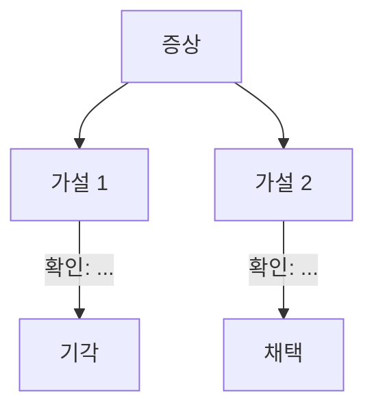
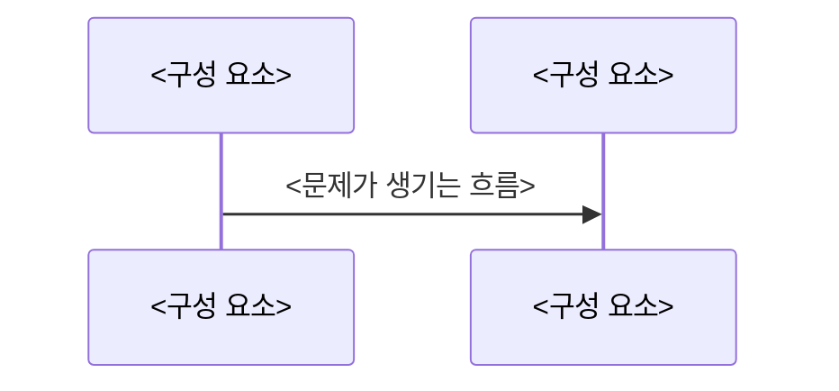

# <증상> → <원인>

| 항목 | 내용 |
| --- | --- |
| 날짜 | YYYY-MM-DD |
| 프로젝트 | <프로젝트 이름> |
| 환경 | <OS, 런타임과 버전, 주요 의존성 버전> |
| 분류 | 버그 / 성능 / 환경·호환성 / 보안 |
| 영향 | <누가, 무엇이, 얼마나> |

## 요약

- 문제: <한 줄>
- 원인: <한 줄>
- 해결: <한 줄>

## 1. 문제

<증상과 재현 조건. 언제, 어떤 입력에서, 어떤 환경에서 생기는가.>

```text
<실제 오류 원문이나 로그. 민감 정보는 가린다.>
```

## 2. 원인 파악 과정

| # | 가설 | 확인 방법 | 결과 |
| --- | --- | --- | --- |
| 1 | <가설> | <명령, 실험, 읽은 코드> | 기각 / 채택: <근거> |



## 3. 원인

<근본 원인. 왜 그 조건에서만 생기는가.>

```text
<관련 코드 발췌: 파일 경로와 줄 번호 포함>
```



## 4. 해결 시도

### 시도 1: <방법>

- 가설: <이 방법이 왜 통할 거라고 봤는가>
- 변경:

```diff
<diff>
```

- 결과: <로그나 수치. 실패했다면 왜 실패했는가>

### 시도 n: <방법>

<성능 개선이면 시도별 비교표를 둔다.>

| 시도 | 측정 조건 | 전 | 후 | 변화 |
| --- | --- | --- | --- | --- |
| 1 | <데이터 크기, 반복 횟수, 환경> | <값> | <값> | <%> |

## 5. 최종 해결과 검증

```diff
<최종 diff>
```

```text
<검증 명령과 실제 결과>
```

<추가한 회귀 테스트>

## 6. 배운 점과 예방책

- 교훈: <다른 상황에도 쓸 수 있게 일반화한 내용>
- 예방책: <테스트, 린트, 검사, 체크리스트>
- 관련 CS 개념: <개념 학습 후보>

## 참고

- <커밋, 이슈, PR, 문서 링크>
